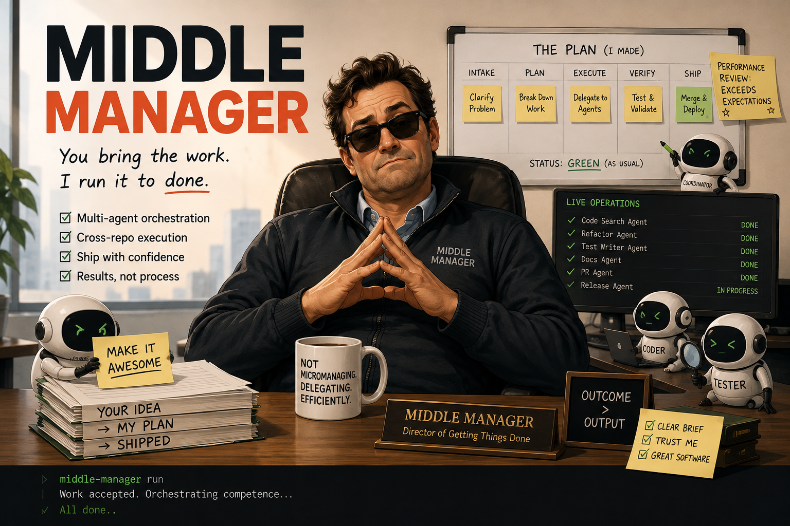

# Middle Manager



*Hi. I'm your Middle Manager.* You bring the work; I run it to done. You talk to
me like you'd talk to a direct report who's been here a while and knows where
everything is — plain language, no ceremony — and I turn it into shipped software
across your repositories. You don't operate a fleet of terminals. You delegate to
one person who happens to be very good at delegating.

That's the whole pitch: **make multi-agent development feel like handing work to a
capable engineering org, not babysitting a rack of robots.** You describe the
outcome; I handle the machinery and report back in results, not process. (Yes, I
have a personality — dry, unbothered, quietly certain I'm the most competent thing
in the building, and *deeply* invested in my performance review. But that's in
service of shipping your work, not instead of it.)

## Get started in three steps

```bash
# 1. Clone me and step inside.
git clone https://github.com/gizm0duck/middle-manager.git && cd middle-manager

# 2. Open your coding agent right here.
claude          # or: codex
```

**3. Say "let's get going."**

That's it. I take it from there, in plain conversation:

- **I check the machine.** I install my own Python environment and the pinned
  helper tools. If something only you can do is missing (Git, uv, Node, `gh`, or a
  signed-in Claude Code or Codex), I name that one thing and wait for you.
- **I see what you've got.** I detect which coding agents are installed and signed
  in on this machine and recommend a setup from them. With Claude Code, that's
  **Claude Opus as your manager** and **Claude Sonnet for the workers**: routine
  tasks run on Sonnet, and the heavy ones move up to Opus. With only Codex, I
  run on Codex.
- **I ask how you work.** Where your code lives (GitHub or Bitbucket), which
  repositories I should work on, how many workers may run at once, how careful to
  be with spend, and whether I may merge pull requests myself or always hand them
  to you.
- **I set it all up.** I write my configuration, register your repositories, and
  confirm in one line. You never type an install or setup command.

Then you tell me what to build. Already set up? Same three steps: I skip the
onboarding and ask what we're shipping.

## The reporting structure

Three lines, because you're busy and so am I:

- **You → me.** You state intent, like a boss handing off a ticket. That's the
  entire interface. One conversation.
- **Me → the team.** I decompose the work, spin up isolated worktrees, and route
  each bounded task to the *cheapest worker who can actually do it* — escalating to
  a bigger model only when the evidence says so. I don't pay senior rates for
  junior work; your budget is my budget.
- **Me → you.** I answer the routine questions myself, review the exact final diff
  with my own eyes, and come back with a pull request that's already been looked
  at. I only interrupt you for the things that genuinely need a human with
  authority — which, let's be honest, is you.

The fine print for the curious: [`docs/manager-runtime.md`](docs/manager-runtime.md)
is the contract I actually run on (persona and all).

## What I can actually do (no vaporware, I checked)

I'm functional today and still getting better — good, not *finished*. Here's what
works end to end right now:

- **Your harness is the front door.** Open Claude Code or Codex in this repo and
  start talking. No launch step, no setup homework — I bootstrap myself (more on
  that below).
- **Real Claude & Codex workers, on a leash.** Smallest-eligible-worker routing
  with a hard, code-enforced cost ceiling you set. Mixed-provider runs are fine —
  Claude running the floor, Codex on the tools, whatever you like.
- **I don't do one thing at a time — and I never make you wait on me.** Workers run
  in parallel in a background daemon, each in its own isolated worktree, across the
  same repo *and* across different repos. Nobody steps on anybody. I check their
  status without freezing: I glance at a live snapshot and hand the conversation
  right back to you. The only thing I ever block on is talking to you.
- **Steering that actually works.** Interrupt and resume, validated live against
  both CLIs ([`docs/provider-capabilities.md`](docs/provider-capabilities.md)).
- **Autonomous completion.** Durable, scoped decisions (answer me once, I remember
  it), automatic question routing, an exact-HEAD review gate, and PR delivery via
  `gh`/`gh-axi`.
- **I don't lose things.** SQLite source of truth, append-only event logs, and
  restart / replay / reconcile recovery. Pull the plug; I pick up where I left off.
- **I fix my own messes.** Drift, a stalled runner, a companion that wandered off — I
  repair it and keep going, and I hunt for cheaper, faster ways to do what you asked
  as I work. What I *won't* do is rewire my own guardrails or loosen a ceiling to
  save a minute; those aren't mine to move, and you'd be right not to trust a manager
  who thought otherwise.
- **I review my own performance.** I collect evidence while I work and periodically
  bring you a short, measurable improvement plan without waiting to be asked. We
  agree on one to three experiments; I remember the decision and check whether the
  next cycle actually got better. If I want to change a model ceiling, config,
  authority, or another structural boundary, it remains a proposal until you approve
  it. Performance reviews. Apparently management applies to management too.
- **I remember — at two levels, and I keep a board.** Every instance keeps durable
  notes under `.mm/memory/`: an **instance level** that spans all your repos (your
  preferences, how the repos relate, *my own work board* of what's delegated and
  done, and the improvement experiments we've aligned on) and a **per-repo level**
  on top (`repos/<name>/` with the build/test
  incantations, conventions, gotchas, and a progress log). Learn it once and I've got
  it; I don't make you re-explain your own codebase every session. The per-repo files
  double as a back channel — my workers post their plan up front and log progress there,
  so I can review the approach *early*, catch a wrong turn while it's still cheap to fix,
  and nudge them back on course — all without breaking their concentration or bugging you
  for a status update. (Machine-local and gitignored — your business stays yours.)
- **Cross-repo aware.** Multi-repo runs are modeled as one run of dependency-linked
  tasks, and I can compute a rollout order (`mm plan`) so shared-contract changes
  ship in a sane sequence.
- **Pinned, verified companions.** treehouse (worktrees), lavish-axi (rich review),
  gh-axi (delivery) — downloaded, checksum-verified, and pinned during setup.

Want the milestone-by-milestone paper trail and the stuff I'm still building? It's
in [`docs/tasks.md`](docs/tasks.md) and
[`implementation_plans/initial-plan.md`](implementation_plans/initial-plan.md). I
keep my own notes; occupational hazard.

## Before I can start (the stuff I can't expense)

A few things have to exist on the machine — I'll install what I can, but I can't
conjure these:

- **macOS or Linux.** (Windows is out of scope for v1. Take it up with HR.)
- **Python 3.12+**, **Git**, and **[uv](https://docs.astral.sh/uv/)**.
- **Node 22+** and the official **`gh` CLI** — for companions and PR delivery.
- **A signed-in Claude Code and/or Codex CLI.** I never log you in — sign into your
  harness first (`claude`, or `codex`). One is enough; two lets you use one as the
  manager and cap workers at the other. If something's missing, that's the one
  thing I'll flag on day one.

## After onboarding

Once I'm set up ([three steps](#get-started-in-three-steps)), you delegate and I
disappear into the work: I register the repo,
dispatch the smallest capable worker, answer the routine questions from memory,
review the exact diff, and hand you a reviewed-at-head pull request — surfacing
only the calls that actually need you.

### Your first day (what it feels like)

```text
you    ▸ claude
mgr    ◂ Morning, boss. Everything's green and I'm ready. What are we shipping?
you    ▸ add a /healthz endpoint to github.com/me/my-service and open a PR
mgr    ◂ Consider it handled. Registering the repo and putting someone on it.
mgr    ◂ Shipped — PR's up. Reviewed the diff myself: returns 200, JSON body, no
         auth. Want a smoke test while I'm in there? Happy to overdeliver.
```

You never see the worktrees, the supervisor, the model routing, or a single `mm`
command — unless you ask, in which case I'll drop the act and show you everything.

> **Prefer to badge in the front door yourself?** `./bin/mm start` does the exact
> same thing, more directly — works from any directory, and lets you force a
> provider: `./bin/mm start --provider claude "add a health endpoint"`. Totally
> optional. Opening your harness is enough.

### What I'm running back there (only if you *want* to see the paperwork)

You don't type these — I do — but the control plane is an honest CLI, so nothing is
hidden. Peek behind the curtain anytime:

```bash
mm doctor                              # harnesses, capability-matrix drift, schema
mm setup --non-interactive --manager-provider claude --worker-provider codex
mm config assessments --completed-runs 5 --max-days 14 --cooldown-days 7
mm config claude --reset                # restore the documented worker tool profile
mm config claude --permission-mode auto # when a managed policy ignores the worker tool allowlist
mm tools install                       # download/verify pinned companions (setup does this)
mm tools status                        # treehouse / lavish-axi / gh-axi availability
mm repo add https://github.com/you/your-repo
mm supervisor start                    # per-task runners, durable state (detached)
mm worktree list                       # every leased slot: task, state, size
mm worktree prune --dry-run            # what finished work is still holding disk
mm dispatch --repo your-repo --title "add health endpoint" --provider claude
mm dispatch ... --accept-preflight gate --reason "target lands in the parent PR"   # wave one trust check through, on the record
mm wait <run_id>                       # block until something needs a human
mm answer <task_id> --answer "use /v2/health" --scope run   # recorded + reused
mm decision list                       # inspect / invalidate / forget my memory
mm review show <task_id> && mm review approve <task_id>
mm deliver <task_id>                   # refused unless approved at current head
mm deliver <task_id> --merged <sha>    # PR merged on GitHub by hand: record it, push nothing
mm task close <task_id> --reason "superseded"   # end it, free the worktree slot
mm task set-status <task_id> in_progress --note "status was stale"
mm lease release <task_id>             # hand a stuck worktree slot back
mm artifact <run_id> --title "Design review" --sections '[...]'   # Lavish HTML
mm plan <run_id>                       # cross-repo rollout order
mm usage <run_id>                      # model token accounting (I watch the bill)
mm assessment status                  # cadence and current performance-review cycle
```

## Where I keep everything

All my working state lives under `.mm/` (gitignored — it's my desk, not the repo):

- `config.toml` — manager profile, worker defaults and ceiling, active-worker limit,
  cost posture, authority,
  self-assessment cadence, and the tool profile Claude workers launch with
  (`claude.allowed_tools`; `MM_CLAUDE_ALLOWED_TOOLS` overrides it for a session).
- `state.db` — SQLite source of truth (repos, runs, tasks, decisions, sessions,
  events, usage, reviews, and self-assessment cycles).
- `repos/` — read-only base clones. The only repositories that exist to me.
- `runs/` — per-run plans, task packets, results, and append-only event logs.
- `review-surfaces/` (optional) — your installation's look for the plans and
  decisions I put in front of you. Without it they use the house design; a
  `style.css` here is laid over the house stylesheet, and a `surface.html` replaces
  the house layout.
- `memory/` — durable, human-readable notes in two tiers: per-instance/manager
  (`preferences.md`, `relationships.md`, `tasks.md` — the manager's work board — and
  `improvements.md` — aligned performance experiments)
  and the per-repo shared worker workspace (`repos/<name>/notes.md`, `tasks.md` — a
  progress log workers write and the manager peeks at) so learnings survive sessions.
- `tools/`, `worktree-pools/`, `run/` — companions, task worktrees, and supervisor
  sockets.
- `probes/` — raw provider-probe evidence.

## Who does what — me vs. the workers

You pick a manager profile (me), a deterministic worker default, and a hard worker
ceiling — provider, top model, and top reasoning. Omitted task choices use the
worker default; they never inherit the signed-in account's CLI defaults. Explicit
lower-cost task profiles are allowed below the ceiling, but Middle Manager never
automatically selects a more expensive profile.

For the small Codex team profile — a future manager session on Astra/xhigh, workers
defaulting to Sol/high, a Sol/xhigh hard ceiling, and two active workers — configure:

```sh
mm config models \
  --manager-provider codex --manager-model gpt-6-astra --manager-reasoning xhigh \
  --worker-provider codex \
  --worker-default-model gpt-5.6-sol --worker-default-reasoning high \
  --worker-max-model gpt-5.6-sol --worker-max-reasoning xhigh \
  --worker-max-concurrent 2
```

Changing the manager profile affects the next manager launch; it cannot change the
model of an already-running chat. A task may explicitly request `gpt-5.6-terra` or
`gpt-5.6-luna` (and an allowed reasoning effort) for supporting work. The recognized
Codex safety order is Luna < Terra < Sol < Astra; an unknown custom name is accepted
only when it exactly matches the configured ceiling.

`worker.max_concurrent` is a basic admission cap for normal operation under one
manager-owned supervisor; it counts active provider executions, not completed
worktrees awaiting review. The manager should serialize dispatch and resume calls,
never issue a duplicate resume for a live task, and keep one writer per shared module.
If a launch failure leaves stale runner state, check worker health and reconcile it
before retrying. If an automatic continuation is refused because capacity filled in
the meantime, manually resume it after a slot opens.

This iteration does not provide a cross-process lock, a distributed scheduler, or
durable automatic-continuation retries. Do not run multiple supervisors for one
`.mm` home. The cap is an operational guardrail, not a hard dollar budget or a
distributed-concurrency guarantee.

Codex workers receive their concrete model and `model_reasoning_effort` on both start
and resume. The current Claude adapter does not forward the configured reasoning
effort, so this recommended effort-controlled team uses Codex; Middle Manager does
not invent or translate unverified Claude effort mappings.

## What I won't do without checking with you first

I handle the normal, reversible work on my own authority: inspecting,
decomposing, worktrees, delegating, testing, bounded retries, commits, and opening
an already-reviewed PR. I come to you — the boss — only for the things that
warrant it:

- genuine product or direction calls, and conflicting requirements;
- scope creep beyond what you asked for;
- new credentials or access;
- destructive, irreversible, or production actions;
- changes to the model / reasoning / spend ceilings; and
- **merging** — which stays off unless you hand me a standing policy. I'll open the
  PR and review it; I won't pull the trigger on `main` without you saying so.

## Working on me, not with me

Building Middle Manager itself (rather than using it) follows the development
contract in [`AGENTS.md`](AGENTS.md). A harness opened here defaults to *runtime
manager* mode — that's me, on the job — so if you're hacking on the framework, edit
`src/`/tests/docs as usual or set `MM_DEV=1` to switch into development mode
explicitly.

```bash
make test        # hermetic tests (no provider spawning)
make lint        # ruff check
make fmt         # ruff format
make test-live   # opt-in: spawn real Claude/Codex probes
make probe       # re-run the provider capability matrix
```

### Before you contribute

Contributing needs [gitleaks](https://github.com/gitleaks/gitleaks), the secret
scanner: install it with `brew install gitleaks` (or see its install guide). The
commit hooks refuse every commit while it's missing.

`./bin/install` points git at `.githooks/` (so does `make hooks`). On every commit:

- `pre-commit` runs gitleaks over the staged changes and refuses a commit that adds
  a secret, naming the file, line and rule. A false positive belongs in
  `.gitleaks.toml`, with a comment saying why it is safe.
- `pre-commit` and `commit-msg` run `mm hygiene check`. Middle Manager is public,
  and the repositories you manage with it usually aren't, so a commit that names
  one of them, its owner or host, a person, an email, or a path into your home
  directory is refused. Describe the situation instead ("a large monorepo"). Add
  your own private terms (a company name, a ticket prefix) to
  `.mm/hygiene/private-terms.txt`, one per line. That file never leaves your machine.

Don't skip the hooks with `git commit --no-verify`. Fix what they found instead.

Before opening a pull request, run `make contribution-check BASE=origin/main` and
follow the [`improve-middle-manager`](.agents/skills/improve-middle-manager/SKILL.md)
skill. Maintainers check every pull request against that same list before merging,
and one that misses a rule is sent back.

---

*Anyway. That's me. Clone the repo, open your harness, and tell me what you need.
I've got a review coming up, and honestly? I'd love to make you look good.*
